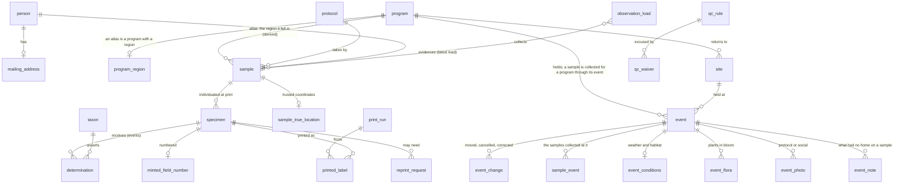

# Schema sketch

> **Status:** the runnable schema lives in [`schema/*.sql`](../schema/) and deliberately covers **less** than this sketch — only what the current roadmap phase needs. Entities sketched here but not yet built — email/mailing addresses, QC waivers, print runs, `minted_field_number` — get re-reviewed against this sketch when their phase arrives. iNat sync history (`sync_run`/`observation_load`, phase 3) and corrections (phase 4) are built now, the latter as load-anchored events per [ADR 0004](adr/0004-correction-overlay.md) rather than this sketch's stored-old-value shape. Naming has also evolved in the implementation: `taxon` → `animal` (the curated taxonomy covers the animal side — specimens and bycatch — while floral hosts are iNat taxon references), `name` → `scientific_name`, and identity follows ADR 0002: entity tables have an `entity_id` PK from the single global `entity_id_seq`; 1:1 facet tables are keyed by their parent. The programs section below is built as it says (2026-10-31, beeline-ni5m.2): `program` is the one table, `atlas_region` assigns states to the programs that are atlases, and `person_membership` is a program id; the atlas-shaped tables kept their `atlas_id` column names, referencing `program`, and there is no `atlas` relation at all, since nothing needs "is an atlas" as a kind (Peter, 2026-10-31). Coordinates were restructured away from this sketch's iNat-inherited shape: the sample layer holds only **believed-true** coordinates (`sample_location`, with a `source` saying why we believe them, and elevation as a property of those coordinates); deliberately-shifted geoprivacy pairs never enter it, remaining verbatim in the staging/observation layer. `sample.latitude`-as-published and `sample_true_location` below are superseded by that shape. Two places the implementation covers **more** than this sketch: `determination` carries a `qualifier` (`cf.`/`aff.`/`nr.`, the open-nomenclature terms that modify a species assertion) and a `verbatim_identification` beside the node it resolved to (beeline-tgu); and `sample_location` records the coordinates an elevation was derived from, so "still about this point" is a question the store can answer rather than a rule every coordinate writer has to remember (beeline-x5c, `schema/170_views_elevation.sql`).

A first concrete rendering of the domain model, for discussion — not an implementation. Vocabulary follows [CONTEXT.md](../CONTEXT.md); the requirements it answers are in [reference-implementation.md](reference-implementation.md). SQL is dialect-neutral where possible; places where the DuckDB-vs-PostgreSQL choice actually bites are called out. Trap-related tables are provisional pending the [staff questions](questions.md).

The design follows three commitments made so far:

1. **Events over current values** where humans assert things: determinations, waivers, corrections, print runs are append-only records of who did what when.
2. **Derived over stored** where facts follow from data: QC findings, printability, determination-of-record are views, never columns.
3. **Decisions snapshot what they saw**: a print run stores the label content and findings it acted on, so later data changes can't rewrite what physically happened.

## Overview



## People and programs

```sql
-- Deliberately anemic: a person is an identity to hang facts on. "Person" (like "user")
-- is the classic god-table smell; every concern lives in its own satellite table with
-- its own privacy and lifecycle, and joining one in is always a deliberate act.
CREATE TABLE person (
  id           INTEGER PRIMARY KEY,
  display_name TEXT NOT NULL
);

-- A person exists before (or without) an iNat account.
CREATE TABLE inat_account (
  person_id    INTEGER PRIMARY KEY REFERENCES person(id),
  inat_user_id BIGINT NOT NULL UNIQUE,   -- the stable key; logins change
  login        TEXT NOT NULL             -- cached for display and matching, refreshed on sync
);

-- Private, like mailing_address: its own table, no accidental joins.
CREATE TABLE email_address (
  person_id  INTEGER PRIMARY KEY REFERENCES person(id),
  email      TEXT NOT NULL,
  bounced_at TIMESTAMP                   -- deliverability: null = believed deliverable
);

-- The other truly private datum. Readable only by the label-printing side;
-- writable by its owner. Every atlas collector SHOULD have one, since their labels are
-- mailed to them; not every person, and not necessarily a BLM collector, whose labels
-- may go to whoever pins for that program instead. So it is a gate on printing rather
-- than a column on person: a sample whose labels have no destination — no address for
-- the primary collector and no label destination for the program — is not pending
-- (Peter, 2026-09-24; where BLM labels go is questions.md, BLM 2).
CREATE TABLE mailing_address (
  person_id  INTEGER PRIMARY KEY REFERENCES person(id),
  address    TEXT NOT NULL,
  updated_at TIMESTAMP NOT NULL
);

-- A program governs what is collected through it (CONTEXT: Program, Governor). There is
-- no atlas table: an ATLAS IS A PROGRAM WITH A REGION — the row in program_region is what
-- makes it one — and everything that used to hang off `atlas` hangs off program: the
-- code, the mark, who prints, membership, the sample's atlas. Master Melittology and the
-- BLM surveys are the rows with no region.
CREATE TABLE program (
  id                 INTEGER PRIMARY KEY,
  code               TEXT UNIQUE NOT NULL,       -- 'OBA', 'WaBA', 'BC', 'ID', 'NM', 'OK', 'MM', 'BLM'
  name               TEXT NOT NULL,
  slug               TEXT UNIQUE NOT NULL,       -- its content page on the site, possibly with subpages
  prints_labels      BOOLEAN NOT NULL DEFAULT false,  -- built as the atlas_printing satellite (schema/010)
  governor_person_id INTEGER REFERENCES person(id)    -- who decides what leaves it
);
-- The region is what an atlas has and the other programs do not. Geographic assignment
-- then costs nothing: iNat stamps observations with place_ids, so "sample fell in atlas
-- A" ≈ A.inat_place_id ∈ observation place_ids; ambiguous or out-of-region samples get
-- explicit assignment (sample_atlas.assigned_by, built). A program's page, /programs/<slug>,
-- possibly with subpages — what it is, how to take part, its protocols — is content, not
-- records; the model holds only the slug. The catch-all — Master Melittology itself,
-- which a sample outside every region is collected for — is known today only by its iNat
-- project's name, "Master Melittologist (outside of Oregon)", and is due a name of its
-- own (Peter, 2026-09-24).
CREATE TABLE program_region (
  program_id    INTEGER PRIMARY KEY REFERENCES program(id),
  inat_place_id BIGINT UNIQUE NOT NULL         -- e.g. Washington = place 46
);
-- Membership (built: person_membership, kind 'atlas' | 'program') becomes a program_id,
-- with "atlas or the program itself" read off whether that program has a region.
```

## Programs, protocols and events

Sketched 2026-09-24 from the BLM conversations ([CONTEXT.md](../CONTEXT.md): Event, Collecting event, Outing, Protocol, Site, Programs and governance; [questions.md](questions.md), BLM surveys). The events part was redrawn on 2026-11-19 (Peter) so that one table serves both the program calendar (beeline-2zej.1) and the collecting event (beeline-85m.2). It was checked against two sets of real cases: Olivia's plot day ([research/blm-protocol-notes.md](research/blm-protocol-notes.md)) and the 107 events the 2026 communiques listed.

An event has two sides, and either may be missing:

- **The announcement** is what a calendar needs: whose event it is, what kind, when, where, and how to register. A Zoom talk has only this side.
- **The report** is what was recorded during the event or after it: who was there, the weather, the plants in bloom, photos, notes, and the samples. A BLM plot day may have only this side: nothing in Olivia's protocol has a plot day entered before it happens, and its weather limits mean the day is often chosen that morning, so its event is created when the first field submission arrives.

In this section an **event** is always the calendar thing. A recorded change to a row (ADR 0007, and the first commitment above) is called a **change**, never an event (Peter, 2026-11-19).

### What DuckDB decides

Production is migrated and never rebuilt (ADR 0006), and three things DuckDB refuses shape these tables. Each is recorded where it first cost something: `schema/030_samples_specimens.sql`, `migrations/0030-print-runs.sql` and ADR 0006.

- **A column that refers to another table cannot be updated on a row that other tables refer to.** Every event is referred to by its changes, samples, photos and notes. So an event's site and protocol are rows in tables beside it (`event_site`, `event_protocol`), as a sample's atlas is. Two sites found to be one can then be merged, which could not be done with a `site_id` column on `event`. An event's program is the exception: it stays on the event and is fixed when the event is created.
- **A migration cannot add a column with a constraint, and cannot add or change a CHECK.** A list of kinds will grow: `area.kind` has been rebuilt three times for a new value, and rebuilding `event` would mean rebuilding every table that refers to it. So `kind` is plain text, checked against the `event_kind` lookup by a view that a test holds empty. The CHECKs that are safe are on the table from the first day.
- **A table that refers to another cannot have a column dropped or renamed.** `site` refers to `program`, so its columns are permanent once built. That is why it waits for a real field submission.

The sketch writes `id` as the rest of this document does. Built, `event` and `site` are entities with an `entity_id` from the one sequence (ADR 0002).

### Decided after the review

A review of this sketch on 2026-11-19 raised six questions. Peter decided four the same day.

- **An event's program is for publicity only.** It says whose calendar the event is on and nothing else. A sample belongs to a program by where it was collected, except a BLM sample, which is BLM's because it came through the BLM surveys' field submissions. So no event, in any program, decides whose a sample is (beeline-85m.2.1).
- **A change to an event is written by whoever makes it,** one row per changed field, with a reason. The form and the API call one function, which writes the event and its change together. Creating an event is not a change. The reasoning is the fourth addendum to [ADR 0007](adr/0007-authored-changes-are-events.md) (beeline-2zej.1.1).
- **The grant to announce for a program is a field on the person overlay,** naming program codes and set on `/people` as `leads` is. The events endpoint of the API stays for staff (beeline-2zej.1.2).
- **Everyone signed in sees an event's general location and its online link. Beeline holds no meeting points.** The program sends the meeting point only to people who signed up, so that nobody arrives who did not, and sign-ups are not in Beeline yet (beeline-2zej.1.3, beeline-2zej.1.11).

### Open before building

- **Loading past events.** A change needs an author and a time, so 2026's cancellations and moves cannot be loaded as they happened. A loader also needs a key of its own for each event, so that running it twice does not make each event twice.
- **A plot day found by program, site and date is only as sound as the match of the site.** A collector types the site's name freehand, and two people's GPS points on one hectare can be 100 m apart. A miss makes a second event, not an error, so this needs a view of likely duplicates and a way to merge them. Three cases have no rule yet: a ten-minute collection that is its own submission, a submission whose date is corrected afterwards, and a submission for a day whose event was cancelled.

Not sketched: days when several people collected at one place without any announcement. On last night's copy of production, 168 place-days in the 2026 season had three or more collectors, and about 117 of them matched no listed event (beeline-85m.2). Peter set these aside on 2026-11-19; the likely feature is making an event's report easy to write after the day.

`program` and `program_region` are defined under People and programs above; this section adds what hangs off them.

```sql
-- A sample that arrived through a program's own field submissions, which is the one way
-- a sample belongs to a program other than by where it was collected. Today that is the
-- BLM surveys alone, through Kobo (Peter, 2026-11-19). No row = by geography.
CREATE TABLE sample_submitted_for (
  sample_id  INTEGER PRIMARY KEY REFERENCES sample(id),
  program_id INTEGER NOT NULL REFERENCES program(id)
);

-- Which program a sample was collected FOR is derived, in order of evidence: the program
-- whose field submissions it arrived through; else the atlas it fell in; else the
-- catch-all, Master Melittology itself. A view, never a table, and its atlas stays a
-- separate fact in sample_atlas, since a BLM sample inside New Mexico is both. An
-- event's program plays no part: it is for publicity only.
CREATE VIEW sample_program AS
SELECT s.id AS sample_id,
       coalesce(sf.program_id, sa.atlas_id, (SELECT id FROM program WHERE code = 'MM')) AS program_id
FROM sample s
LEFT JOIN sample_submitted_for sf ON sf.sample_id = s.id
LEFT JOIN sample_atlas sa ON sa.sample_id = s.id;   -- built (schema/010); atlas_id is a program with a region

-- How a sample was taken: shared reference data, like animal_rank, never free text and
-- owned by no program — every atlas uses the same net protocol, or nearly the same, and
-- a "nearly" is its own row. A row says what the protocol FIXES, so effort is never
-- smuggled into a string. grain='event' rows are a day's shape (the BLM plot day); their
-- sample-level columns are NULL. Which sample protocols make up an event protocol is NOT
-- stored: with one event protocol in existence its parts are its written protocol's to
-- say, and a composition table now would be guessing its cardinality. It arrives with the
-- second event protocol, as a check that a sample's protocol belongs to its event's.
CREATE TABLE protocol (
  id               INTEGER PRIMARY KEY,
  code             TEXT UNIQUE NOT NULL,   -- 'net', 'trap', 'net-10min', 'pan-6h', 'plot-day'
  name             TEXT NOT NULL,
  grain            TEXT NOT NULL CHECK (grain IN ('sample', 'event')),
  method           TEXT CHECK (method IN ('net', 'pan trap', 'vane trap', 'nest block')),
  duration_minutes INTEGER,                -- fixed by the protocol: 10, 360; NULL = not fixed
  records_times    BOOLEAN,                -- start and end are recorded, not assumed
  host_per_sample  BOOLEAN,                -- one floral host per sample (one vial per plant)
  zero_is_record   BOOLEAN,                -- a session with no bees is still a record
  label_host       BOOLEAN,                -- the host prints on the label
  label_time       BOOLEAN                 -- the collection time prints on the label
);
-- sample gains time_start TIME and time_end TIME, and a sample_protocol table beside it
-- (sample_id, protocol_id), since a migration cannot add a column with a reference.
-- The legacy protocol strings ("6 Vane Traps") map onto protocol rows by curation and
-- stay verbatim beside them; they never constrain the table.

-- A place a program returns to: a BLM plot, which is a permanent hectare that is never
-- moved and is visited several times a year, and probably the spot a trap is serviced
-- at over a season. It is what ties this June's visit to last June's. A site is
-- identified by where it is; its name is what the people who work there call it,
-- recorded as written, never parsed and not unique (CONTEXT: Site code).
-- PROVISIONAL: nobody enters a site ahead of time. A row is made when a field
-- submission first names one, so the columns wait on a real export from the field tool,
-- and so does the rule for "the same site again" (her protocol says both 300 m and 500 m).
CREATE TABLE site (
  id         INTEGER PRIMARY KEY,
  program_id INTEGER NOT NULL REFERENCES program(id),   -- whose people set it up
  name       TEXT NOT NULL,                             -- 'EMPP1'
  latitude   DOUBLE NOT NULL,                           -- its centre
  longitude  DOUBLE NOT NULL
);

-- One table for everything a program puts on its calendar and everything it reports on
-- afterwards. Created before, during or after its dates. The name is a label and never
-- a key. An event at a site is identified by the program, the site and the dates, which
-- is how the second collector's submission for a plot day finds the first one's event.
-- An outing (one person's road trip) is deliberately not here.
CREATE TABLE event (
  id          INTEGER PRIMARY KEY,
  program_id  INTEGER NOT NULL REFERENCES program(id),  -- an atlas, or MM for the whole program
  kind        TEXT NOT NULL,                     -- an event_kind code. No CHECK and no foreign
                                                 -- key: see "What DuckDB decides" below.
  collecting  BOOLEAN NOT NULL,                  -- held to collect bees, whether or not any
                                                 -- are caught. Separate from kind:
                                                 -- 12 of 2026's field days were also trainings.
                                                 -- Only a collecting event takes samples.
  name        TEXT NOT NULL,                     -- 'Cottonwood Canyon, 12 Jun 2027'
  series      TEXT,                              -- 'Catch a Buzz': each session is its own row
  details     TEXT,                              -- plain text

  -- When. A wall-clock appointment, not an instant, so not a UTC TIMESTAMP: a local date
  -- range, an optional local time, and the IANA zone the time is in.
  date_start  DATE NOT NULL,
  date_end    DATE NOT NULL,                     -- four days in West Central Idaho are one event
  time_start  TIME,                              -- on each day of the event, not only the first
  time_end    TIME,
  time_zone   TEXT,                              -- 'America/Los_Angeles'. A time needs one; a zone
                                                 -- alone says which zone a deadline's day ends in

  cancelled_at TIMESTAMP,                        -- NULL = not cancelled
  created_by  INTEGER NOT NULL REFERENCES person(id),
  created_at  TIMESTAMP NOT NULL,
  -- These three are here from the first day, because a CHECK can never be added later.
  CHECK (date_end >= date_start),
  CHECK (time_start IS NULL OR time_zone IS NOT NULL),
  CHECK (time_end IS NULL OR time_start IS NOT NULL)
);

-- The kinds an event may have. A lookup the event's kind is checked against by a view
-- of events whose kind is not listed, which a test holds empty.
CREATE TABLE event_kind (
  code TEXT PRIMARY KEY,   -- 'field day', 'microscope session', 'talk', 'meeting', 'course',
  name TEXT NOT NULL       -- 'conference', 'outreach', 'deadline', 'other'
);

-- Where and how, each in a table beside the event that nothing refers to, so every
-- column stays writable and each can be built when its step arrives. No row = none:
-- a deadline has no place, a field day has no online link.
CREATE TABLE event_place (       -- the general location, which everyone signed in may see
  event_id   INTEGER PRIMARY KEY REFERENCES event(id),
  name       TEXT NOT NULL,                      -- 'Cottonwood Canyon State Park'
  latitude   DOUBLE,                             -- of the place as a whole. Never a meeting
                                                 -- point: Beeline holds none (see above)
  longitude  DOUBLE,
  CHECK ((latitude IS NULL) = (longitude IS NULL)),
  CHECK (latitude BETWEEN -90 AND 90),
  CHECK (longitude BETWEEN -180 AND 180)
);
CREATE TABLE event_site (        -- a site the program returns to
  event_id INTEGER PRIMARY KEY REFERENCES event(id),
  site_id  INTEGER NOT NULL REFERENCES site(id)
);
CREATE TABLE event_protocol (    -- an event-grain protocol: the plot day
  event_id    INTEGER PRIMARY KEY REFERENCES event(id),
  protocol_id INTEGER NOT NULL REFERENCES protocol(id)
);
CREATE TABLE event_online (
  event_id INTEGER PRIMARY KEY REFERENCES event(id),
  url      TEXT NOT NULL
);
-- Registration stays where it is today (Ideal Logic, Google Forms, WSDA's page).
CREATE TABLE event_registration (
  event_id    INTEGER PRIMARY KEY REFERENCES event(id),
  url         TEXT NOT NULL,
  register_by DATE
);

-- Six of 2026's 107 events were cancelled and five were moved. Each is a change that
-- says who made it and when, and the event's page shows it: "moved from 12 June". The
-- event row holds the current values. Append-only, the shape of the sample change log.
-- Built on 2026-11-19 as schema/075_events.sql, which is now the authority for event,
-- its kinds, place, online link, registration and this log (docs/architecture/events.md).
CREATE TABLE event_change (
  change_id  INTEGER NOT NULL,                   -- one per request, shared by its fields; the
                                                 -- log is read in this order
  event_id   INTEGER NOT NULL REFERENCES event(id),
  changed_at TIMESTAMP NOT NULL,
  author_id  INTEGER REFERENCES person(id),      -- NULL = made outside Beeline and loaded
  source     TEXT NOT NULL,                      -- 'form', 'api' or 'load'
  field      TEXT NOT NULL,                      -- 'date_start', 'place', 'cancelled_at'
  old_value  TEXT,
  new_value  TEXT,
  reason     TEXT,
  PRIMARY KEY (change_id, field)
);

-- Who was there. For a training whose attendance counts towards certification, the
-- record stays in Ideal Logic and Beeline does not copy it.
CREATE TABLE event_attendance (
  event_id  INTEGER NOT NULL REFERENCES event(id),
  person_id INTEGER NOT NULL REFERENCES person(id),
  PRIMARY KEY (event_id, person_id)
);

-- A sample belongs to at most one event; no row = none, as with sample_atlas. A legacy
-- sample joins an event a person creates for it; none is minted from the legacy records.
-- Olivia's timed session (a 45-minute net session whose bees go into one vial per plant)
-- gets no table: its vials are samples that share a start time and collectors.
CREATE TABLE sample_event (
  sample_id INTEGER PRIMARY KEY REFERENCES sample(id),
  event_id  INTEGER NOT NULL REFERENCES event(id)
);

-- What a plot day's protocol requires of the report, beside the event because a talk
-- has no weather. PROVISIONAL: the columns follow her paper plot form (protocol
-- pp. 149-153) and are settled when a real field submission has been seen.
CREATE TABLE event_conditions (
  event_id          INTEGER PRIMARY KEY REFERENCES event(id),
  habitat           TEXT,       -- grassland, sagebrush, riparian-wetland, pinyon-juniper, ...
  habitat_condition TEXT,
  temperature_start     DOUBLE, -- four readings on her form; unit to settle (°F on paper)
  temperature_end       DOUBLE,
  temperature_morning   DOUBLE,
  temperature_afternoon DOUBLE,
  cloud_cover       TEXT,       -- full sun, 1/4, 1/2, 3/4, overcast
  precipitation     TEXT,
  wind_morning      DOUBLE,     -- mph on paper
  wind_afternoon    DOUBLE,
  weather_notes     TEXT
);

-- Every plant in bloom in the plot, with how many. The field tool sends one string,
-- "Genus species abundance; ...", which is split on arrival and kept as written.
CREATE TABLE event_flora (
  event_id        INTEGER NOT NULL REFERENCES event(id),
  name_as_written TEXT NOT NULL,                 -- 'Asteraceae #1 - photo' is allowed
  plant_taxon_id  BIGINT,                        -- resolved later, or NULL
  abundance       TEXT                           -- her log scale: exact under 20, tens, hundreds, '1000+'
);

-- Photos and notes hold what has no home on a sample. The bytes live in an object store
-- chosen before this is built; the row holds the key. A protocol photo is evidence and
-- carries the rare-plant question; a social photo carries faces.
CREATE TABLE event_photo (
  id         INTEGER PRIMARY KEY,
  event_id   INTEGER NOT NULL REFERENCES event(id),
  kind       TEXT NOT NULL CHECK (kind IN ('protocol', 'social')),
  object_key TEXT NOT NULL,
  taken_at   TIMESTAMP,
  taken_by   INTEGER REFERENCES person(id),
  caption    TEXT
);
CREATE TABLE event_note (
  id        INTEGER PRIMARY KEY,
  event_id  INTEGER NOT NULL REFERENCES event(id),
  author_id INTEGER NOT NULL REFERENCES person(id),
  noted_at  TIMESTAMP NOT NULL,
  body      TEXT NOT NULL                        -- access, phenology, what was learned
);
-- An event has one report however many days it ran: the notes, photos, attendance and
-- samples all hang off the one row. Parent events (Darwin Core's shape) are left out
-- until somebody wants a report for each day of a longer event as well.
-- Later, maybe: event_track (event_id, person_id, object_key) for a GPS track, the one
-- thing an outing holds that a sample cannot. Belongs to whoever walked it.
```

### Worked example: a BLM plot day

Two people survey plot `EMPP1` on 2027-06-12, pan traps out 08:45 to 14:45 and two net sessions between. Nothing is entered beforehand. Each collector sends one submission for the day. The first to arrive creates the event, and the site too if this is the plot's first visit; the second finds that event by program, site and date and joins it. Everything is edited in Beeline from then on.

| Table | Row |
| --- | --- |
| `program` | `BLM`, "BLM bee surveys", governor: Olivia |
| `protocol` | `plot-day` (grain event); `pan-6h` (sample, pan trap, 360 min, times recorded, zero is a record); `net-10min` (sample, net, 10 min, times recorded, host per sample, zero is a record, host and time on the label) |
| `site` | program `BLM`, name `EMPP1`, the plot's centre; already there if the plot was visited in May |
| `event` | program `BLM`, kind field day, collecting, "EMPP1, 12 Jun 2027", 2027-06-12 to 2027-06-12, no time |
| `event_site`, `event_protocol` | site `EMPP1`; protocol `plot-day`. No place, online link or registration, so no rows for those |
| `event_attendance` | Olivia; a contractor |
| `event_conditions` | sagebrush; 68 °F at the start, 84 °F at the end; 1/4 cloud; no precipitation; wind 4 mph in the morning, 9 mph in the afternoon |
| `event_flora` | *Penstemon* sp., 40; *Eriogonum* sp., 200; *Cleome serrulata*, 12 |
| `sample` × 4 | one pan-trap sample, `pan-6h`, 08:45–14:45, 61 specimens; three net samples, `net-10min`, one vial per plant, 09:20 *Penstemon*, 09:35 *Eriogonum* (0 specimens, still a record), 13:10 *Cleome* |
| `sample_event` × 4 | all four on the one event |
| `sample_submitted_for` × 4 | `BLM`, because they arrived through the BLM surveys' field submissions. This, and not the event, is what makes them BLM samples |
| `sample_atlas` × 4 | `NM`, derived from where the plot is — not written by anything here |
| `event_photo` | two protocol photos (the plot, the *Penstemon* stand); one social photo of the pair at the truck |
| `event_note` | "Gate on the county road locked; combination from the field office. *Eriogonum* just opening." |

The pan-trap sample and the net samples are distinct samples within one event, and the trap sample's specimens carry the six-hour window, not a day. Nothing here decides which of the two collectors' Kobo submissions is the record (questions.md, 17).

### Worked example: an atlas event with legacy samples

A Washington Bee Atlas collecting day at a state park on 2024-05-18, recorded in 2027 because the group photo had nowhere to go.

| Table | Row |
| --- | --- |
| `event` | program `WaBA`, kind field day, collecting, "Cottonwood Canyon, 18 May 2024", created 2027-03-02 by the coordinator |
| `event_place` | "Cottonwood Canyon State Park". No site and no protocol |
| `event_attendance` | the six people whose samples are attached, plus two who collected nothing |
| `sample_event` | eleven legacy samples from that date and place, attached by hand; their `sample_number`s are untouched and still run per collector per day |
| `sample_program` (view) | `WaBA`, through the atlas they fell in, exactly as before the event existed: attaching a sample to an event never changes its program. A legacy sample outside every atlas resolves to the catch-all |
| `event_photo` | one social photo |
| `event_note` | "Balsamroot past peak by mid-May here; a week earlier next year." |

A field training is the same row with `collecting` false, and no samples.

### Worked example: the calendar, from the 2026 communiques

Four of the 107 events the communiques listed between January and October 2026. None has a report.

| Event | Row |
| --- | --- |
| A monthly talk | program `MM`, kind talk, not collecting, "Catch a Buzz", series "Catch a Buzz", 2026-11-10, 18:00 `America/Los_Angeles`, an online link. Each month's session is its own row; nothing stores a rule for repeating. |
| A microscope training | program `WaBA`, kind microscope session, not collecting, 2026-11-13, place name "WSU Vancouver", a registration link to WSDA's events page, register by 2026-11-08 |
| A deadline | program `MM`, kind deadline, "Master Level proposals due", 2026-10-30, no time and no place |
| A field day that moved | program `OBA`, kind field day, collecting, its new date on the row; one `event_change` with field `date_start`, the old and new dates, who moved it and why. A cancelled event keeps its row, with `cancelled_at` set and one `event_change`. |

Of the 107, 44 were for the whole program and so belong to `MM`; 31 were online; 29 were collecting, 12 of those also trainings.

## Curated taxonomy

```sql
CREATE TABLE taxon (
  id         INTEGER PRIMARY KEY,
  parent_id  INTEGER REFERENCES taxon(id),
  rank       TEXT NOT NULL,   -- must include suborder & superfamily (Symphyta, Ichneumonoidea)
  name       TEXT NOT NULL,
  authorship TEXT
);
```

Bees to species; non-bee scaffold deep enough for wasps at species rank (seeded on demand from Ecdysis's taxonomic thesaurus, the program's basis for bees and bycatch alike since 2026-10-23 — beeline-7gob; ITIS before it, beeline-45v). The curation layer over it is built as `animal_curation` ([schema/022](../schema/022_animal_curation.sql), beeline-45v.1): git-versioned decisions in `ingest/taxon-curation.csv`, each a taxonomist's, replayed on every rebuild. *Open: versioning mechanics beyond that — an append-only `taxon_change` log, after cutover, per ADR 0007.* Floral hosts do **not** live here — they are iNat taxon references on the sample.

## Ingestion (observation history)

```sql
-- One execution of a fetch over one source+window. Incomplete runs write no loads;
-- unauthenticated runs abort — never silently anonymous.
CREATE TABLE sync_run (
  id            INTEGER PRIMARY KEY,
  source        TEXT NOT NULL,            -- iNat project id (provenance only, never assignment)
  window_start  DATE,
  window_end    DATE,
  started_at    TIMESTAMP NOT NULL,
  completed_at  TIMESTAMP                 -- null ⇒ failed; nothing persisted
);

-- Append-only: a new row only when the whitelisted projection's hash changes.
-- The pipeline is a pure transform over these rows — that's what makes it re-runnable.
CREATE TABLE observation_load (
  id           INTEGER PRIMARY KEY,
  inat_id      BIGINT NOT NULL,
  sync_run_id  INTEGER NOT NULL REFERENCES sync_run(id),
  fetched_at   TIMESTAMP NOT NULL,
  content      JSON NOT NULL,             -- whitelisted projection, not the raw response
  content_hash TEXT NOT NULL
);
-- Current state of an observation = its latest load (a view).
-- Deletion detection: absent from a *complete* run that should have covered it.
```

## Samples and specimens

Nullability here is a stance, not an accident. **Identity fields are NOT NULL**: a record without a collector, date, and sample number isn't identifiable as a sample — an observation missing those stays at the observation stage (with a QC finding) until fixed. **Descriptive fields are nullable because completeness is QC's job**: incomplete data must be storable to be fixable in-app, and the QC rules — not the schema — define "complete enough to print." Host is nullable for the genuine no-host case; atlas until assignment.

```sql
CREATE TABLE sample (
  id                 INTEGER PRIMARY KEY,
  kind               TEXT NOT NULL,       -- 'net' | 'trap'
  collector_id       INTEGER NOT NULL REFERENCES person(id),
  -- atlas: the built shape is the sample_atlas satellite (schema/010, beeline-6e9), whose
  -- atlas_id is a program with a region and whose assigned_by is null ⇒ by geography
  sample_number      TEXT NOT NULL,       -- '3' (net: per collector per day) | 'OBAS-00657' (trap series)
  date_start         DATE NOT NULL,
  date_end           DATE NOT NULL,       -- = date_start for net; range for trap
  specimen_count     INTEGER NOT NULL DEFAULT 0,     -- the working count: free to move until printing
  inat_observation_id BIGINT,             -- evidence link, when iNat-documented
  host_inat_taxon_id BIGINT,              -- iNat taxonomy, by role (see CONTEXT)
  host_name_as_observed TEXT,
  -- Coordinates as iNat publishes them: possibly shifted by geoprivacy.
  -- True coordinates live in sample_true_location; both are kept (see below).
  latitude           DOUBLE,
  longitude          DOUBLE,
  coordinate_uncertainty_m INTEGER,
  geoprivacy         TEXT,                -- null | 'obscured' | 'private', user- or taxon-driven
  country TEXT, state_province TEXT, county TEXT, locality TEXT,
  elevation_m        INTEGER,
  protocol           TEXT,                -- legacy free text; becomes protocol_id → protocol (shared reference data, above)
  sampling_effort    TEXT                 -- trap-count × trap-days etc. TBD (Q6)
);

-- Specimens are individuated by printing. Until a print run freezes, a sample has only
-- a specimen_count, free to move up or down (count corrections, trap batches). Creating
-- a print run creates the specimen rows it prints, mints their numbers, and snapshots
-- their labels. Historical ingestion also lands here — production is 99.9997% printed.
CREATE TABLE specimen (
  id              INTEGER PRIMARY KEY,
  sample_id       INTEGER NOT NULL REFERENCES sample(id),
  specimen_number INTEGER NOT NULL,       -- 1..N within the sample at freeze time
  field_number    TEXT,                   -- opaque verbatim text: all four historical eras land here
  created_at      TIMESTAMP NOT NULL,
  UNIQUE (sample_id, specimen_number)
);

-- True coordinates from trusted authenticated reads, isolated like mailing_address:
-- joining them in is a deliberate act, never an accident. Both pairs are always
-- retained. Whether an atlas may *reveal* them for taxon-obscured records (labels,
-- app, exports) is a per-atlas policy/regulatory question — open, and a blocker
-- before go-live (see questions.md).
CREATE TABLE sample_true_location (
  sample_id  INTEGER PRIMARY KEY REFERENCES sample(id),
  latitude   DOUBLE NOT NULL,
  longitude  DOUBLE NOT NULL
);
```

Consequences worth naming: before printing, QC and self-service operate at the **sample** level (there are no specimen rows to flag); a count *decrease* before printing is just an edit, and only after printing becomes a finding (printed specimens vs current count). A canceled print run's numbers stay burned — sequence gaps are harmless, reuse never is.

**No global UNIQUE on `specimen.field_number`** — history forbids it (`25051768` exists twice on paper). Instead, uniqueness is a hard guarantee only for what Beeline itself mints:

```sql
-- The governed sequence. Insert here *is* the mint; the PRIMARY KEY is the guarantee.
CREATE TABLE minted_field_number (
  field_number   TEXT PRIMARY KEY,
  specimen_id    INTEGER NOT NULL UNIQUE REFERENCES specimen(id),
  minted_at      TIMESTAMP NOT NULL
);
```

Legacy numbers are attributes; minted numbers are governed. (This sidesteps needing partial unique indexes, which PostgreSQL has and DuckDB lacks — the two-table shape is dialect-neutral.)

A specimen-count *decrease* upstream doesn't delete specimen rows; it surfaces as a derived QC finding (specimen rows vs latest observation count).

## Determinations (events)

```sql
CREATE TABLE determination (
  id              INTEGER PRIMARY KEY,
  specimen_id     INTEGER NOT NULL REFERENCES specimen(id),
  taxon_id        INTEGER NOT NULL REFERENCES taxon(id),
  sex             TEXT,
  caste           TEXT,
  determiner_id   INTEGER REFERENCES person(id),
  determiner_name TEXT,                 -- imports name people we may not resolve
  is_expert       BOOLEAN NOT NULL,
  channel         TEXT NOT NULL,        -- 'in_app' | 'ecdysis_import' | ...
  determined_on   DATE,                 -- when made, if known
  recorded_at     TIMESTAMP NOT NULL,   -- when it crossed into Beeline (drives notifications)
  notes           TEXT
);
-- determination_of_record: a VIEW. Provisional rule: latest expert determination wins;
-- else latest volunteer determination. To confirm with staff.
```

Append-only: a correction is a newer event, never an edit. The volunteer draft/commit boundary lives in the app, not here — only deliberate assertions become rows.

## Quality control

Rule *definitions* are SQL views, one per rule, each producing `(specimen_id or sample_id, rule_name, details)`; `qc_finding` is their UNION — derived, never stored. Rule *metadata* is data:

```sql
CREATE TABLE qc_rule (
  name         TEXT PRIMARY KEY,
  severity     TEXT NOT NULL,            -- 'blocking' | 'warning'
  waivable     BOOLEAN NOT NULL,
  instructions TEXT NOT NULL             -- the self-service "what to do" copy
);

CREATE TABLE qc_waiver (
  id           INTEGER PRIMARY KEY,
  rule_name    TEXT NOT NULL REFERENCES qc_rule(name),
  specimen_id  INTEGER REFERENCES specimen(id),
  sample_id    INTEGER REFERENCES sample(id),
  excused_hash TEXT NOT NULL,            -- hash of the flagged values; waiver lapses if they change
  author_id    INTEGER NOT NULL REFERENCES person(id),
  note         TEXT,
  created_at   TIMESTAMP NOT NULL
);
```

**Printability** (view, over *samples*): all label-required fields present ∧ no blocking finding without a live waiver ∧ obscured samples have a `sample_true_location` row (a taxon-obscured sample with one prints like any other; Peter, 2026-11-20) ∧ `specimen_count > 0`. A print run freezes printable samples into specimens.

## Corrections

One shape for volunteer self-fixes, staff overrides, and accepted machine-proposed rewrites — differing only in author and kind:

```sql
CREATE TABLE correction (
  id         INTEGER PRIMARY KEY,
  entity     TEXT NOT NULL,              -- 'sample' | 'specimen' | 'person'
  entity_id  INTEGER NOT NULL,
  field      TEXT NOT NULL,
  old_value  TEXT,
  new_value  TEXT,
  author_id  INTEGER NOT NULL REFERENCES person(id),
  kind       TEXT NOT NULL,              -- 'self_fix' | 'staff_override' | 'machine_proposed'
  reason     TEXT,
  created_at TIMESTAMP NOT NULL
);
```

*Design point resolved by [ADR 0004](adr/0004-correction-overlay.md):* corrections are a three-way-merge overlay anchored on the load the corrector saw (that load is the base). Upstream unchanged → correction applies; upstream converged → correction still applies (no auto-retirement since beeline-9z4); both moved → the correction stands and a `correction_conflict` finding opens. Conflicts resolve only by a new correction based on the current load.

## Label governance

Built (beeline-1kb.2, 2026-09-17): [schema/035_print_runs.sql](../schema/035_print_runs.sql) holds `print_run`, `minted_field_number` and `printed_label`, and [schema/155_views_print_run.sql](../schema/155_views_print_run.sql) says what they mean. Two things the sketch had here were superseded before they were built, both by [ADR 0008](adr/0008-specimen-identity.md): the run's `state` column is derived from its timestamps instead, and the registry is one row per *number* rather than 1:1 with the specimen, so a duplicate repair can mint a second number without losing the first. `reprint_request` is still to come (beeline-1kb.5), and `printed_label`'s `(print_run_id, specimen_id)` key is the room left for it. Proofing pulls (beeline-1kb.3) and the artifact-lifecycle theme are open; the field-number half of that theme is decided by the ADR (nothing is voided; a superseded number is a non-current registry row).

## Deliberately absent, for now

- **Trap sites / deployments / servicing** — sketched only as `sample.kind='trap'` + series numbers until the staff questions come back. The entities are coming; guessing their shape now would just be wrong.
- **Roles/permissions** — high-trust environment; `atlas_printing` (built, schema/010: a row means the atlas prints its own labels) plus a person↔atlas staff link when a need appears.
- **Administration** — *who staffs* a person, as distinct from where they belong. `person_membership` records membership only (beeline-lcl); program-only volunteers are supported by OBA staff, and until a second administering body exists there is nothing for the model to tell apart. Arrives with the staff link above, not before.
- **Notifications/feed** — derivable from `determination.recorded_at` and print-run events when that scope opens.
- **Ecdysis/GBIF export tables** — exports consume the model; they shouldn't shape it. (Ecdysis is Washington's repository integration, not core.)
